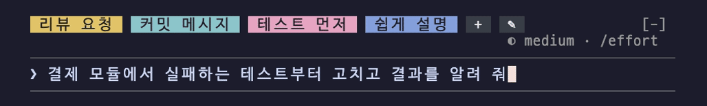

# 붙임 메모

> 자주 쓰는 문구를 입력창 위에 색깔 칩으로 붙여 두고, 한 번 클릭하면 복사, 두 번 클릭하면 입력창에 넣어요



| | |
| --- | --- |
| 설치 이름 | `sticky-memo` |
| 종류 | 오리지널 |
| 만든 사람 | [SeongGwangJu](https://github.com/SeongGwangJu) |
| 라이선스 | MIT |
| 유형 | 🧰 도구 |
| 보이는 곳 | 터미널 · 데스크톱 앱 |
| 명령어 | `/sticky` |
| 권한 | 💬 프롬프트 입력 · 👀 대화 읽기 |

## 설치

Claude Code 안에서:

```
/plugin marketplace add SeongGwangJu/k-mods
/plugin install sticky-memo@k-mods
```

터미널에서:

```sh
claude plugin marketplace add SeongGwangJu/k-mods
claude plugin install sticky-memo@k-mods
```

이미 열려 있는 세션에는 `/reload-plugins`로 바로 적용돼요. Claude Code 2.1.287 이상이 필요해요.

## 이 mod가 내 컴퓨터에서 하는 일

- 💬 **프롬프트 입력**.
- 👀 **대화 읽기**.

<details><summary>정적 분석 결과 (<code>claude plugin validate</code>)</summary>

- 검사한 Claude Code: 2.1.296
- 결과: 통과
- 다루는 이벤트: `command.run{command=sticky}`, `prompt.submit`, `session.start`, `ui.message`, `ui.render{component=AbovePrompt}`
- 부르는 API: `$.clock.after`, `$.clock.every`, `$.clock.now`, `$.command.register`, `$.prompt.fill`, `$.prompt.read`, `$.state.get`, `$.state.set`, `$.store.get`, `$.store.set`, `$.ui.copy`, `$.ui.resolve`, `$.ui.toast`

</details>

## 검토 기록

- 2026-10-11 · k-mods · Claude Code 2.1.296 · 정적 검사, 코드 읽기, 테스트, 실제 세션 확인

## 더 보기

- [mod 설명서](../../mods/sticky-memo/README.md)
- [카탈로그로 돌아가기](../../README.md#mod-목록)
